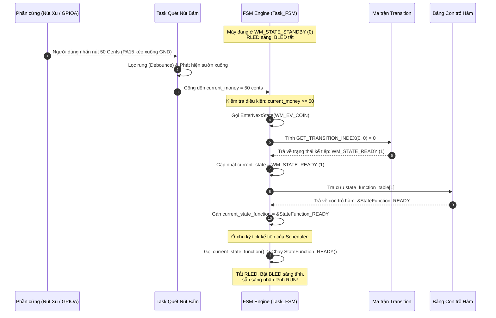

# TÀI LIỆU GIẢI THÍCH CHUYÊN SÂU: CƠ CHẾ HOẠT ĐỘNG CỦA MA TRẬN CHUYỂN TRẠNG THÁI 2D (STATE TRANSITION MATRIX)
## Dự án: STM-FSM_WashingMachine (CO3053 - Embedded Systems)

---

## 1. Giới thiệu & Đặt vấn đề

Trong thiết kế phần mềm nhúng (Embedded Software Engineering), **Máy trạng thái hữu hạn (Finite State Machine - FSM)** là mô hình chuẩn mực nhất để điều khiển các hệ thống phản ứng (Reactive Systems) như máy giặt, thang máy, đèn giao thông hay vi điều khiển công nghiệp.

Để hiện thực FSM trong mã nguồn C/C++, lập trình viên thường đứng trước 2 lựa chọn:
1. **Cách tiếp cận truyền thống (Nested Switch-Case / If-Else):**
   * Sử dụng các khối `switch (current_state)` lồng bên trong là `switch (event)`.
   * *Nhược điểm:* Khi số lượng trạng thái và sự kiện tăng lên, mã nguồn phình to nhanh chóng (Spaghetti code), rất khó bảo trì, kiểm thử và thời gian thực thi phụ thuộc vào số lượng nhánh rẽ (không xác định - non-deterministic).
2. **Cách tiếp cận hướng dữ liệu (Table-Driven FSM / State Transition Matrix):**
   * Tách biệt hoàn toàn giữa **dữ liệu cấu hình chuyển trạng thái** (lưu trong mảng/bảng ma trận) và **logic thực thi** (các hàm nghiệp vụ).
   * *Ưu điểm:* Thời gian tra cứu là hằng số $O(1)$, code gọn gàng, có tính module hóa cao và cực kỳ dễ mở rộng.

Dự án **STM-FSM_WashingMachine** của chúng ta áp dụng mô hình **Table-Driven FSM**. Tài liệu này giải thích chi tiết bản chất toán học, cấu trúc dữ liệu, cách bố trí bộ nhớ và luồng thực thi của Ma trận 2D trong dự án.

---

## 2. Bản chất Toán học của Ma trận 2D FSM

Về mặt lý thuyết tự động hữu hạn (Automata Theory), một máy trạng thái hữu hạn được biểu diễn bằng bộ 5 thành phần:
$$M = (S, \Sigma, \delta, s_0, F)$$
Trong đó:
* $S$: Tập hợp hữu hạn các trạng thái có thể có của hệ thống (`FSM_State`).
* $\Sigma$: Tập hợp hữu hạn các sự kiện/tín hiệu đầu vào (`FSM_Event`).
* $\delta$: Hàm chuyển trạng thái (State Transition Function):
  $$\delta: S \times \Sigma \rightarrow S$$
  Ý nghĩa: Nhận vào một cặp **(Trạng thái hiện tại $s$, Sự kiện xảy ra $e$)** và trả về **Trạng thái kế tiếp $s'$**.
* $s_0$: Trạng thái khởi đầu ($s_0 \in S$, ở đây là `WM_STATE_STANDBY`).
* $F$: Tập hợp các trạng thái kết thúc (nếu có).

### 2.1. Biểu diễn hàm $\delta$ dưới dạng Bảng Ma trận 2D
Một hàm ánh xạ 2 chiều $\delta(s, e)$ tự nhiên nhất được biểu diễn bằng một bảng chữ nhật (Ma trận 2D):
* **Hàng (Row $i$):** Tương ứng với trạng thái hiện tại $s_i \in S$.
* **Cột (Column $j$):** Tương ứng với sự kiện $e_j \in \Sigma$.
* **Ô tại vị trí $(i, j)$:** Lưu giá trị của trạng thái tiếp theo $s' = \delta(s_i, e_j)$.

$$\text{Next State} = \text{TransitionMatrix}[\text{Current State}][\text{Event}]$$

---

## 3. Bảng Ma trận 2D Toàn diện cho Bài toán Máy Giặt

Hệ thống máy giặt của chúng ta có:
* **Số lượng trạng thái:** `STATE_COUNT = 5` ($S = \{0, 1, 2, 3, 4\}$)
* **Số lượng sự kiện:** `EVENT_COUNT = 6` ($\Sigma = \{0, 1, 2, 3, 4, 5\}$)

Dưới đây là ma trận chuyển trạng thái đầy đủ được xây dựng dựa trên đặc tả kỹ thuật của bài toán:

| Trạng thái hiện tại \ Sự kiện đầu vào | `WM_EV_COIN` (0) <br> *(Nạp xu)* | `WM_EV_BTN_RUN` (1) <br> *(Nhấn RUN)* | `WM_EV_BTN_PAUSE` (2) <br> *(Nhấn PAUSE)* | `WM_EV_BTN_STOP` (3) <br> *(Nhấn STOP)* | `WM_EV_TIMEOUT` (4) <br> *(Hết 30 phút)* | `WM_EV_FAULT` (5) <br> *(Báo lỗi)* |
| :--- | :---: | :---: | :---: | :---: | :---: | :---: |
| **Hàng 0: `WM_STATE_STANDBY`** <br> *(RLED ON, tiền < 50c)* | **`WM_STATE_READY`** <br> *(nếu tiền $\ge$ 50c)* | `WM_STATE_STANDBY` <br> *(Bỏ qua)* | `WM_STATE_STANDBY` <br> *(Bỏ qua)* | `WM_STATE_STANDBY` <br> *(Bỏ qua)* | `WM_STATE_STANDBY` <br> *(Bỏ qua)* | **`WM_STATE_ERROR`** |
| **Hàng 1: `WM_STATE_READY`** <br> *(BLED ON, tiền $\ge$ 50c)* | `WM_STATE_READY` <br> *(Nhận thêm tiền)* | **`WM_STATE_RUNNING`** <br> *(Xóa tiền, bật timer)* | `WM_STATE_READY` <br> *(Bỏ qua)* | **`WM_STATE_STANDBY`** <br> *(Hủy bỏ / reset)* | `WM_STATE_READY` <br> *(Bỏ qua)* | **`WM_STATE_ERROR`** |
| **Hàng 2: `WM_STATE_RUNNING`** <br> *(BLED Blink, giặt)* | `WM_STATE_RUNNING` <br> *(Bỏ qua)* | `WM_STATE_RUNNING` <br> *(Bỏ qua)* | **`WM_STATE_PAUSED`** <br> *(Tạm dừng, timer chạy)* | **`WM_STATE_STANDBY`** <br> *(nếu nhấn đúp 2 lần)* | **`WM_STATE_STANDBY`** <br> *(Giặt xong 30 phút)* | **`WM_STATE_ERROR`** |
| **Hàng 3: `WM_STATE_PAUSED`** <br> *(BLED ON, timer chạy)* | `WM_STATE_PAUSED` <br> *(Bỏ qua)* | **`WM_STATE_RUNNING`** <br> *(Tiếp tục giặt)* | `WM_STATE_PAUSED` <br> *(Bỏ qua)* | **`WM_STATE_STANDBY`** <br> *(nếu nhấn đúp 2 lần)* | **`WM_STATE_STANDBY`** <br> *(Hết giờ khi pause)* | **`WM_STATE_ERROR`** |
| **Hàng 4: `WM_STATE_ERROR`** <br> *(RLED Blink, báo động)* | `WM_STATE_ERROR` <br> *(Khóa nhận tiền)* | `WM_STATE_ERROR` <br> *(Khóa chạy)* | `WM_STATE_ERROR` <br> *(Khóa pause)* | **`WM_STATE_STANDBY`** <br> *(Reset lỗi về ban đầu)* | `WM_STATE_ERROR` <br> *(Bỏ qua)* | `WM_STATE_ERROR` <br> *(Bỏ qua)* |

---

## 4. Kỹ thuật "Phẳng hóa" Ma trận (Matrix Flattening & Row-Major Order)

### 4.1. Tại sao không khai báo mảng 2 chiều trực tiếp `matrix[5][6]`?
Trong ngôn ngữ C/C++, việc khai báo:
```cpp
FSM_State state_transition_table[STATE_COUNT][EVENT_COUNT];
```
về mặt bản chất phần cứng máy tính vẫn được trình biên dịch (Compiler) xếp thành một chuỗi byte liên tục trong bộ nhớ RAM/ROM.

Tuy nhiên, việc sử dụng một mảng phẳng 1 chiều:
```cpp
static FSM_State state_transition_table[STATE_COUNT * EVENT_COUNT];
```
kết hợp một macro tính toán chỉ số mang lại các ưu điểm lớn trong lập trình nhúng:
1. **Truyền nhận dữ liệu linh hoạt:** Con trỏ mảng 1D `FSM_State*` truyền vào các hàm kiểm tra, hàm nạp dữ liệu hay hàm kiểm thử đơn vị (Unit Test) đơn giản hơn nhiều so với con trỏ mảng 2D kích thước cố định `FSM_State (*)[6]`.
2. **Kiểm soát tối ưu ô nhớ:** Dễ dàng `memset`, `memcpy`, hoặc ánh xạ vào vùng nhớ Flash cố định (`const`) để tiết kiệm RAM.
3. **Hiểu rõ nguyên lý Row-Major:** Giúp lập trình viên nắm quyền kiểm soát trực tiếp cách bố trí bộ nhớ của vi điều khiển.

---

### 4.2. Công thức Toán học của Row-Major Order
Theo quy ước **Row-Major Order** (xếp theo thứ tự hàng trước, cột sau), các hàng của ma trận được đặt nối tiếp nhau trong bộ nhớ:
* Hàng 0 chiếm các ô nhớ đầu tiên.
* Hàng 1 bắt đầu ngay sau khi Hàng 0 kết thúc.
* Hàng $i$ bắt đầu sau khi toàn bộ $i$ hàng trước đó kết thúc.

Vì **mỗi hàng có độ dài bằng số lượng cột (tức `EVENT_COUNT`)**, vị trí của phần tử ở **Hàng `state`** và **Cột `event`** được tính bằng công thức:

$$\mathbf{Index = (state \times EVENT\_COUNT) + event}$$

* **Thành phần $(\text{state} \times \text{EVENT\_COUNT})$:** Bước nhảy qua các hàng trước đó (Row Offset). Mỗi hàng bước qua đúng `EVENT_COUNT` ô nhớ.
* **Thành phần $+ \text{event}$:** Độ lệch của cột bên trong hàng hiện tại (Column Offset).

---

### 4.3. Sơ đồ Bố trí Bộ nhớ RAM (Memory Layout Map)

Với `STATE_COUNT = 5` và `EVENT_COUNT = 6`, tổng số ô nhớ là $5 \times 6 = 30$ phần tử:

```
Địa chỉ Mảng 1D (Index từ 0 đến 29):

Index:  [ 0   1   2   3   4   5 ]  --> Hàng 0: WM_STATE_STANDBY
        [ 6   7   8   9  10  11 ]  --> Hàng 1: WM_STATE_READY
        [ 12  13  14  15  16  17 ]  --> Hàng 2: WM_STATE_RUNNING
        [ 18  19  20  21  22  23 ]  --> Hàng 3: WM_STATE_PAUSED
        [ 24  25  26  27  28  29 ]  --> Hàng 4: WM_STATE_ERROR
```

#### Ví dụ tra cứu cụ thể:
Giả sử máy đang ở trạng thái **`WM_STATE_RUNNING` (giá trị enum = 2)** và sự kiện xảy ra là **`WM_EV_BTN_PAUSE` (giá trị enum = 2)**:
* Tính chỉ số:
  $$\text{Index} = (2 \times 6) + 2 = 12 + 2 = \mathbf{14}$$
* Truy xuất phần tử: `state_transition_table[14]` $\rightarrow$ Giá trị trả về là **`WM_STATE_PAUSED` (3)**.
* Thao tác này chỉ tốn: 1 phép nhân, 1 phép cộng, và 1 phép đọc ô nhớ RAM $\rightarrow$ Thời gian thực thi cực nhanh (chưa tới 5 chu kỳ xung nhịp CPU ARM Cortex-M3).

---

## 5. Mổ xẻ Chi tiết Lỗi Kỹ thuật: Phân tích Bug Xung đột Ô nhớ (Memory Collision)

Đây là điểm cực kỳ quan trọng cần lưu ý trong khung code gốc của dự án.

### 5.1. Khảo sát đoạn mã bị lỗi trong `include/fsm.h`
Trong file [`include/fsm.h`](file:///c:/Users/ADMIN/Documents/ES-WashingMachine_FSM_Implementation/STM-FSM_WashingMachine/include/fsm.h#L29) hiện tại:
```cpp
#define STATE_COUNT 5
#define EVENT_COUNT 6

// ❌ ĐOẠN CODE BỊ BUG:
#define GET_TRANSITION_INDEX(state, event) ((state) * STATE_COUNT + (event))
```

### 5.2. Chứng minh Toán học về Hiện tượng Ghi đè Bộ nhớ
Vì tác giả vô tình nhân với `STATE_COUNT` (5) thay vì `EVENT_COUNT` (6), bước nhảy giữa các hàng chỉ có 5 ô, trong khi mỗi hàng thực tế có 6 sự kiện (từ event 0 đến event 5).

Hãy quan sát 2 phép tra cứu độc lập sau:

#### Trường hợp 1: Máy ở trạng thái `READY` (1) gặp lỗi phần cứng `FAULT` (5)
* `state = 1` (`WM_STATE_READY`)
* `event = 5` (`WM_EV_FAULT`)
* Áp dụng công thức sai:
  $$\text{Index}_1 = (1 \times 5) + 5 = 5 + 5 = \mathbf{10}$$

#### Trường hợp 2: Máy ở trạng thái `RUNNING` (2) nhận sự kiện nạp xu `COIN` (0)
* `state = 2` (`WM_STATE_RUNNING`)
* `event = 0` (`WM_EV_COIN`)
* Áp dụng công thức sai:
  $$\text{Index}_2 = (2 \times 5) + 0 = 10 + 0 = \mathbf{10}$$

### 💥 Hậu quả thực tế:
Hai ô nhớ hoàn toàn khác nhau trong bảng ma trận lại bị trỏ vào **cùng một vị trí bộ nhớ `Index = 10`**!
* Khi bạn cấu hình chuyển trạng thái cho `(READY, FAULT) = ERROR`, ô số 10 mang giá trị `ERROR`.
* Nhưng khi bạn cấu hình `(RUNNING, COIN) = RUNNING`, giá trị này sẽ **ghi đè** đè lên ô số 10.
* Kết quả: Khi máy đang `READY` mà bị lỗi `FAULT`, thay vì chuyển sang `ERROR`, máy lại nhảy sang `RUNNING`! Hệ thống sẽ bị sai lệch hoàn toàn về mặt logic điều khiển.

### 5.3. Bảng Đối chiếu So sánh Trực quan

| Cặp (State, Event) | Công thức SAI: `state * 5 + event` | Công thức ĐÚNG: `state * 6 + event` | Nhận xét |
| :--- | :---: | :---: | :--- |
| `(STANDBY, FAULT)` = (0, 5) | $0 \times 5 + 5 = \mathbf{5}$ | $0 \times 6 + 5 = \mathbf{5}$ | Trùng ngẫu nhiên ở hàng 0 |
| `(READY, COIN)` = (1, 0) | $1 \times 5 + 0 = \mathbf{5}$ | $1 \times 6 + 0 = \mathbf{6}$ | ⚠️ **Xung đột ở Index 5!** |
| `(READY, FAULT)` = (1, 5) | $1 \times 5 + 5 = \mathbf{10}$ | $1 \times 6 + 5 = \mathbf{11}$ | |
| `(RUNNING, COIN)` = (2, 0) | $2 \times 5 + 0 = \mathbf{10}$ | $2 \times 6 + 0 = \mathbf{12}$ | ⚠️ **Xung đột ở Index 10!** |
| `(RUNNING, FAULT)` = (2, 5) | $2 \times 5 + 5 = \mathbf{15}$ | $2 \times 6 + 5 = \mathbf{17}$ | |
| `(PAUSED, COIN)` = (3, 0) | $3 \times 5 + 0 = \mathbf{15}$ | $3 \times 6 + 0 = \mathbf{18}$ | ⚠️ **Xung đột ở Index 15!** |

> [!CAUTION]
> Với công thức sai, cứ mỗi bước chuyển hàng, ô cuối cùng của hàng trước (`event = 5`) sẽ bị đè bẹp vào ô đầu tiên của hàng kế tiếp (`event = 0`). Đây là lỗi kinh điển khi phẳng hóa ma trận mà mọi kỹ sư nhúng phải tuyệt đối tránh!

---

## 6. Mối liên kết giữa Ma trận Chuyển trạng thái và Bảng Con trỏ hàm

Kiến trúc FSM trong dự án kết hợp 2 bảng tra cứu hoạt động song song nhịp nhàng:

```
                                      +------------------------------------+
                                      |     state_transition_table         |
                                      |  (Ma trận 2D: Quy định ĐI ĐÂU)     |
                                      +------------------------------------+
                                                        │
                      (Current State, Event)            ▼
                           ─────────────►       next_state (Enum)
                                                        │
                                                        ▼
                                      +------------------------------------+
                                      |      state_function_table          |
                                      |  (Bảng con trỏ hàm: LÀM CÁI GÌ)   |
                                      +------------------------------------+
                                                        │
                                                        ▼
                                            current_state_function
                                         (Thực thi logic nghiệp vụ)
```

1. **`state_transition_table` (Data-driven Routing):**
   * Quyết định: *“Khi đang ở trạng thái A mà gặp sự kiện B thì trạng thái tiếp theo là gì?”*
   * Chỉ lưu dữ liệu tĩnh (enum).
2. **`state_function_table` (Execution Mapping):**
   * Quyết định: *“Trạng thái tương ứng sẽ do hàm C/C++ nào đảm nhiệm việc thực thi?”*
   * Lưu con trỏ hàm:
     ```cpp
     state_function_table[WM_STATE_STANDBY] = StateFunction_STANDBY;
     state_function_table[WM_STATE_READY]   = StateFunction_READY;
     state_function_table[WM_STATE_RUNNING] = StateFunction_RUNNING;
     state_function_table[WM_STATE_PAUSED]  = StateFunction_PAUSED;
     state_function_table[WM_STATE_ERROR]   = StateFunction_ERROR;
     ```

### Phân tích luồng thực thi trong `EnterNextState()`:
Để chuyển trạng thái an toàn, hàm phải thực hiện đúng 3 bước:
```cpp
static void EnterNextState(FSM_Event event)
{
    // Bước 1: Tra cứu ma trận 2D tìm trạng thái kế tiếp
    uint8_t index = GET_TRANSITION_INDEX(current_state, event);
    FSM_State next_state = state_transition_table[index];

    // Bước 2: CẬP NHẬT TRẠNG THÁI HIỆN TẠI (Code gốc đang bị thiếu dòng này!)
    current_state = next_state;

    // Bước 3: Đổi con trỏ hàm sang hàm nghiệp vụ của trạng thái mới
    current_state_function = state_function_table[current_state];
}
```

---

## 7. Sơ đồ Tuần tự Thực thi Thực tế (Step-by-step Walkthrough)

Dưới đây là kịch bản người dùng bỏ đủ 50 cents tiền xu khi máy đang ở chế độ chờ `STANDBY`:



---

## 8. Đánh giá Hiệu năng & Kinh nghiệm Thiết kế trong Hệ thống Nhúng

| Tiêu chí | Tiếp cận dùng Ma trận 2D (Dự án này) | Tiếp cận dùng Nested Switch-Case |
| :--- | :--- | :--- |
| **Độ phức tạp thời gian** | **$O(1)$ tuyệt đối** (Tính toán 1 phép nhân + cộng) | $O(N)$ (Phụ thuộc vào số lượng nhánh case phải duyệt) |
| **Tính xác định (Determinism)** | **Rất cao** (Số chu kỳ CPU không đổi trong mọi tình huống) | Kém (Các state ở cuối switch-case mất nhiều thời gian hơn) |
| **Bộ nhớ RAM tiêu thụ** | 30 bytes (rất nhỏ trên vi điều khiển có 10KB RAM) | Gần như 0 bytes RAM (nhưng tốn thêm Flash cho lệnh nhảy `CMP`/`BNE`) |
| **Bộ nhớ Flash (Code Size)** | Mã nguồn cực kỳ gọn gàng, kích thước Flash nhỏ | Mã nguồn phình to do nhiều lệnh rẽ nhánh điều kiện |
| **Khả năng mở rộng** | Khi thêm State/Event: chỉ cần tăng kích thước ma trận và điền thêm dữ liệu | Phải sửa đổi sâu vào cấu trúc logic, dễ sinh bug hồi quy |

### 💡 Lời khuyên thiết kế cho Co-partner:
1. Khi cấu hình ma trận trong `StateFunction_INIT()`, nên dùng vòng lặp khởi tạo toàn bộ các ô chưa dùng về một giá trị an toàn (ví dụ: giữ nguyên trạng thái cũ `current_state` hoặc chuyển sang `WM_STATE_ERROR`) trước khi gán các ô hợp lệ.
2. Để tiết kiệm RAM hơn nữa trong các dự án thương mại lớn, bảng ma trận này hoàn toàn có thể được khai báo với từ khóa `const` để trình biên dịch đặt thẳng vào bộ nhớ Flash (ROM) thay vì chiếm dụng RAM.
