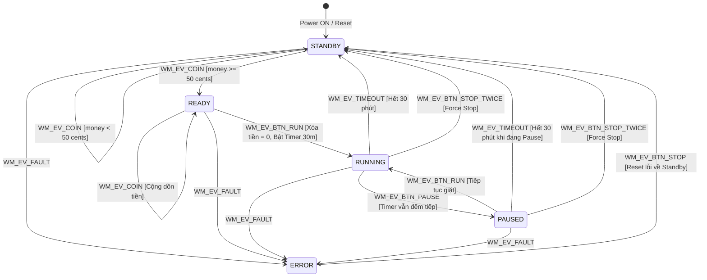

# BÁO CÁO PHÂN TÍCH & KẾ HOẠCH TRIỂN KHAI (TODO REPORT)
## Đề tài: Thiết kế Khối Điều khiển Máy Giặt bằng FSM (CO3053 - Embedded Systems)

---

Chào bạn đồng hành (co-partner)! Dưới đây là bản báo cáo chi tiết mà tôi đã tổng hợp từ yêu cầu trong slide bài giảng (**CO3053 - Assignment**) kết hợp với việc khảo sát toàn bộ mã nguồn hiện tại trong thư mục dự án `STM-FSM_WashingMachine`.

Báo cáo này phân tích cặn kẽ các yêu cầu, chỉ ra những lỗi tiềm ẩn có sẵn trong khung code khung (skeleton code), lên danh sách **TODO** cùng **hướng giải quyết chi tiết** cho từng hạng mục để chúng ta chuẩn bị thực hiện từng bước.

---

## 1. Phân tích Yêu cầu Đề bài (System Specifications)

Dựa trên slide bài giảng:
* **Hệ thống điều khiển gồm:**
  * **3 nút chức năng:** `RUN`, `PAUSE`, `STOP` (kết nối ở GPIOB: PB0, PB1, PB2 - Pull-up).
  * **3 nút nạp tiền xu:** Nhận các đồng `10-cent`, `20-cent`, `50-cent` (kết nối ở GPIOA: PA1, PA2, PA15 - Pull-up).
  * **2 đèn LED chỉ báo:**
    * **Đèn Đỏ (RLED - PB13):**
      * Sáng tĩnh (**ON**): Máy ở chế độ chờ (**STANDBY** - sẵn sàng phục vụ).
      * Nhấp nháy (**BLINKING**): Máy phát hiện lỗi (**ERROR**).
    * **Đèn Xanh (BLED - PB14):**
      * Sáng tĩnh (**ON**): Đủ tiền, máy sẵn sàng vận hành (**READY**).
      * Nhấp nháy (**BLINKING**): Máy đang thực hiện chu trình giặt (**RUNNING**).
* **Quy tắc Tài chính (Coin Handling):**
  * Chỉ chấp nhận các mệnh giá xu: 10-cent, 20-cent, 50-cent.
  * Máy chỉ được phép chạy khi đã nạp **tối thiểu 50 cents** (`total_money >= 50`).
  * Khi nhấn `RUN`, chu trình bắt đầu, toàn bộ số tiền sẽ bị xóa về 0 (`clear without returning the redundancies`). Không thối tiền thừa.
* **Quy tắc Thời gian & Vận hành (Timer & Operational Cycle):**
  * Chu trình giặt tiêu chuẩn: **30 phút**.
  * Bắt đầu đếm ngược khi nhấn `RUN` từ trạng thái `READY`.
  * Khi đang giặt (`RUNNING`), nếu nhấn `PAUSE`: máy chuyển sang trạng thái tạm dừng (**PAUSED**), **nhưng bộ đếm thời gian 30 phút vẫn tiếp tục đếm ngược** (*"the timer is still counting down"*).
  * Từ `PAUSED`, nếu nhấn `RUN`, máy tiếp tục chu trình giặt (**RUNNING**).
  * Kết thúc chu trình: Tự động kết thúc khi hết 30 phút, hoặc khi người dùng **nhấn nút STOP 2 lần liên tiếp** (*"STOP button is pressed twice (force to stop)"*). Khi kết thúc, máy quay về trạng thái `STANDBY`.

---

## 2. Khảo sát Hiện trạng Codebase & Phát hiện Bug nghiêm trọng có sẵn

Khi kiểm tra các file mã nguồn có sẵn, hệ thống đang sử dụng kiến trúc:
* **Hardware config:** `helper.h` & `helper.cpp` cấu hình GPIO (các nút nhấn dùng chế độ Input Pull-up, LED Output) và Timer `TIM2` ngắt chu kỳ 10ms. Có chú thích đặc biệt: *"Không được động k là máy nổ :D"* -> Ta giữ nguyên và tái sử dụng các chân/hàm này.
* **Bộ lập lịch:** `scheduler.h` & `scheduler.cpp` hiện thực bộ lập lịch tác vụ dạng hàng đợi Delta-queue hợp tác (cooperative scheduler), tick 10ms.
* **Khung FSM:** `fsm.h` & `fsm.cpp` thiết kế theo dạng bảng chuyển trạng thái (State Transition Table) kết hợp con trỏ hàm.

### ⚠️ Các Bug & Lỗ hổng kỹ thuật phát hiện trong khung code hiện tại:

1. **Bug sai chỉ số ma trận chuyển trạng thái (`GET_TRANSITION_INDEX`) trong `include/fsm.h` (CỰC KỲ NGUY HIỂM):**
   ```cpp
   // Hiện tại trong fsm.h:
   #define STATE_COUNT 5
   #define EVENT_COUNT 6
   #define GET_TRANSITION_INDEX(state, event) ((state) * STATE_COUNT + (event)) // SAI!
   ```
   * *Nguyên nhân:* Mảng phẳng hóa từ ma trận 2D `[STATE_COUNT][EVENT_COUNT]` có kích thước mỗi hàng là `EVENT_COUNT` (6 cột).
   * *Hậu quả:* Nhân với `STATE_COUNT` (5) làm lệch chỉ số ô nhớ, dẫn tới trùng lắp chỉ số giữa các state khác nhau (ví dụ: State 1 Event 5 có index là 10, trong khi State 2 Event 0 cũng có index là 10!).
   * *Khắc phục:* Phải sửa thành:
     ```cpp
     #define GET_TRANSITION_INDEX(state, event) ((state) * EVENT_COUNT + (event))
     ```

2. **Hàm `EnterNextState()` không cập nhật biến trạng thái `current_state` (`src/fsm.cpp`):**
   ```cpp
   static void EnterNextState(FSM_Event event)
   {
       current_state_function = state_function_table[state_transition_table[GET_TRANSITION_INDEX(current_state, event)]];
   }
   ```
   * *Nguyên nhân:* Hàm chỉ đổi con trỏ hàm `current_state_function` mà quên gán `current_state = next_state;`.
   * *Hậu quả:* Biến `current_state` sẽ mãi mãi kẹt ở `WM_STATE_STANDBY`, lần chuyển trạng thái kế tiếp sẽ tra cứu sai hoàn toàn!

3. **Khởi tạo mảng `state_transition_table` mặc định không an toàn:**
   * Cú pháp `FSM_State state_transition_table[...] = {WM_STATE_ERROR};` trong C/C++ chỉ gán phần tử đầu tiên là `WM_STATE_ERROR`, còn lại đều tự động điền giá trị 0 (`WM_STATE_STANDBY`). Các transition không hợp lệ sẽ vô tình đưa máy về `STANDBY` thay vì giữ nguyên hoặc báo lỗi. Cần hàm memset hoặc khởi tạo rõ ràng toàn bộ bảng.

4. **Chưa có tầng xử lý nút bấm (Button Debouncing & Edge Detection):**
   * Các nút nhấn vật lý khi bấm sẽ bị rung (bouncing) và tín hiệu giữ mức LOW kéo dài qua nhiều tick. Nếu đọc trực tiếp trong FSM, 1 lần nhấn có thể bị nhận diện thành hàng chục sự kiện liên tiếp.
   * Cần có một Task riêng quét nút bấm định kỳ (10ms - 20ms) để lọc nhiễu, bắt sườn xuống (Falling Edge - khi nút được nhấn).

5. **Chưa có cơ chế nhận diện nút `STOP` nhấn 2 lần ("Double Press"):**
   * Đề bài yêu cầu: *“STOP button is pressed twice (force to stop)”*. Cần một bộ đo thời gian (timer window ví dụ ~1.5 - 2 giây) để xác định nhấn đúp.

6. **Chưa có biến quản lý tiền và đếm thời gian 30 phút:**
   * Cần cấu trúc lưu biến `current_money` và `remaining_time`.
   * Đối với kiểm thử / mô phỏng trên Proteus: Chu kỳ 30 phút thực tế (1800 giây) là quá dài để chấm bài hay quan sát. Ta cần thiết kế cơ chế cấu hình thời gian linh hoạt (Scale Factor) để khi chạy thử có thể chỉnh thành 30 giây nhằm kiểm tra nhanh.

---

## 3. Thiết kế Mô hình Máy Trạng Thái (FSM Architecture)

### 3.1. Sơ đồ Chuyển trạng thái (State Diagram)



### 3.2. Bảng Trạng thái Đèn LED theo từng Chế độ

| Trạng thái FSM | Red LED (`PIN_LED_RED` - PB13) | Blue LED (`PIN_LED_BLUE` - PB14) | Ghi chú từ đề bài |
| :--- | :--- | :--- | :--- |
| **WM_STATE_STANDBY** | **SÁNG TĨNH (ON)** | **TẮT (OFF)** | Máy sẵn sàng phục vụ, tiền < 50c |
| **WM_STATE_READY** | **TẮT (OFF)** | **SÁNG TĨNH (ON)** | Đã nạp đủ >= 50c, chờ nhấn RUN |
| **WM_STATE_RUNNING** | **TẮT (OFF)** | **NHẤP NHÁY (BLINK)** | Đang giặt, timer 30p đếm ngược |
| **WM_STATE_PAUSED** | **TẮT (OFF)** | **SÁNG TĨNH (hoặc giữ)** | Tạm dừng, timer 30p **vẫn đếm tiếp** |
| **WM_STATE_ERROR** | **NHẤP NHÁY (BLINK)** | **TẮT (OFF)** | Có lỗi, chờ bấm STOP để reset |

---

## 4. Danh sách TODO và Kế hoạch Thực hiện (Action Plan)

Dưới đây là các đầu việc cần làm, chia theo từng giai đoạn rõ ràng:

### Phase 1: Chuẩn hóa & Khắc phục Lỗ hổng FSM Engine Core
- [ ] **TODO 1.1:** Sửa macro `GET_TRANSITION_INDEX` trong `include/fsm.h` thành `((state) * EVENT_COUNT + (event))`.
- [ ] **TODO 1.2:** Sửa hàm `EnterNextState` trong `src/fsm.cpp` để cập nhật đúng `current_state = next_state;` và thực thi hàm trạng thái mới.
- [ ] **TODO 1.3:** Khởi tạo an toàn cho `state_transition_table` (mặc định giữ nguyên trạng thái hoặc chuyển sang `WM_STATE_ERROR` khi gặp event không hợp lệ).
- [ ] **TODO 1.4:** Bổ sung event `WM_EV_BTN_STOP_TWICE` (nhấn STOP 2 lần) hoặc hàm kiểm tra điều kiện chuyển trạng thái cho nút STOP.

### Phase 2: Xây dựng Module Xử lý Nút nhấn & Tiền xu (Button & Coin Driver)
- [ ] **TODO 2.1:** Viết bộ lọc rung chống dội (Software Debounce) cho 6 nút nhấn (RUN, PAUSE, STOP, 10c, 20c, 50c) chạy theo chu kỳ 10ms - 20ms.
- [ ] **TODO 2.2:** Bắt sự kiện nhấn 1 lần (Single Press - Falling edge detection) để tránh kích hoạt liên tục khi người dùng giữ nút.
- [ ] **TODO 2.3:** Hiện thực bộ nhận diện **Nhấn đúp (Double-press detection)** cho nút `STOP`:
  - Khi nhấn STOP lần 1: Bật bộ đếm thời gian chờ (ví dụ: 1.5 giây).
  - Nếu nhấn tiếp lần 2 trong khoảng thời gian này: Phát sự kiện `FORCE_STOP`.
  - Nếu hết thời gian chờ mà không bấm lại: Hủy trạng thái chờ đúp.
- [ ] **TODO 2.4:** Xử lý sự kiện nạp tiền (Coin Buttons):
  - Phím 10c -> cộng 10.
  - Phím 20c -> cộng 20.
  - Phím 50c -> cộng 50.
  - Khi ở `STANDBY`, nếu tổng tiền đạt `>= 50`, phát sinh sự kiện chuyển sang `READY`.

### Phase 3: Quản lý Bộ đếm thời gian 30 phút (Timer & Simulation Scaler)
- [ ] **TODO 3.1:** Xây dựng biến đếm ngược thời gian giặt `wash_time_remaining` (đơn vị giây).
- [ ] **TODO 3.2:** Tạo macro định nghĩa thời gian chu trình:
  - Chế độ thực tế: `30 * 60` giây.
  - Chế độ Test/Mô phỏng (Proteus): `30` giây (1 giây mô phỏng tương ứng 1 phút).
- [ ] **TODO 3.3:** Viết hàm cập nhật đếm ngược (gọi định kỳ mỗi 1 giây hoặc tích hợp vào Task đếm giờ). Bộ đếm này hoạt động khi máy ở trạng thái **RUNNING** VÀ cả khi ở **PAUSED**.
- [ ] **TODO 3.4:** Khi `wash_time_remaining == 0`, tự động kích hoạt event `WM_EV_TIMEOUT` để đưa máy về `STANDBY`.

### Phase 4: Hoàn thiện Logic cho từng State Function trong FSM
- [ ] **TODO 4.1:** `StateFunction_STANDBY()`:
  - Đảm bảo RLED sáng, BLED tắt.
  - Xóa biến thời gian đếm ngược.
  - Nhận tiền xu, cộng dồn. Khi tiền `>= 50`, chuyển sang `WM_STATE_READY`.
- [ ] **TODO 4.2:** `StateFunction_READY()`:
  - RLED tắt, BLED sáng.
  - Vẫn cho phép nhét thêm tiền nếu muốn (cộng dồn).
  - Lắng nghe nút `RUN`: Nếu được nhấn, xóa trắng tiền (`current_money = 0`), đặt `wash_time_remaining = 30 mins`, chuyển sang `WM_STATE_RUNNING`.
- [ ] **TODO 4.3:** `StateFunction_RUNNING()`:
  - BLED nhấp nháy (chu kỳ 1s: 500ms ON, 500ms OFF). RLED tắt.
  - Lắng nghe nút `PAUSE`: Nếu được nhấn, chuyển sang `WM_STATE_PAUSED`.
  - Lắng nghe nút `STOP x 2`: Chuyển về `WM_STATE_STANDBY`.
  - Lắng nghe `TIMEOUT`: Khi hết giờ, chuyển về `WM_STATE_STANDBY`.
- [ ] **TODO 4.4:** `StateFunction_PAUSED()`:
  - BLED sáng tĩnh (hoặc giữ đèn), RLED tắt.
  - Timer tiếp tục đếm ngược.
  - Lắng nghe nút `RUN`: Nếu được nhấn, quay lại `WM_STATE_RUNNING`.
  - Lắng nghe nút `STOP x 2` hoặc `TIMEOUT`: Chuyển về `WM_STATE_STANDBY`.
- [ ] **TODO 4.5:** `StateFunction_ERROR()`:
  - RLED nhấp nháy cảnh báo lỗi. BLED tắt.
  - Lắng nghe nút `STOP`: Nhấn STOP để xóa lỗi, quay về `WM_STATE_STANDBY`.

### Phase 5: Xây dựng Module Điều khiển LED (LED Driver)
- [ ] **TODO 5.1:** Tách riêng logic điều khiển LED hoặc tạo Task LED chạy chu kỳ 100ms - 200ms để quản lý trạng thái ON/OFF/BLINK của RLED và BLED mượt mà, không phụ thuộc vào delay chặn (non-blocking).

### Phase 6: Tích hợp vào Scheduler (`main.cpp`) & Kiểm thử
- [ ] **TODO 6.1:** Đăng ký các Task vào bộ Scheduler trong `main.cpp`:
  - `Task_ButtonScan`: chạy mỗi 20ms (chu kỳ 2 ticks).
  - `Task_FSM`: chạy mỗi 50ms - 100ms (chu kỳ 5 - 10 ticks).
  - `Task_TimerTick`: chạy mỗi 1000ms (chu kỳ 100 ticks).
  - `Task_LEDController`: chạy mỗi 100ms (chu kỳ 10 ticks).
- [ ] **TODO 6.2:** Kiểm thử các kịch bản thực tế (Test Cases):
  1. Nạp 10c + 20c = 30c (vẫn ở STANDBY, RLED ON).
  2. Nạp thêm 20c = 50c (chuyển sang READY, BLED ON).
  3. Nạp thừa 20c = 70c (vẫn ở READY, BLED ON).
  4. Bấm RUN -> Tiền về 0, chuyển sang RUNNING, BLED chớp, đếm ngược bắt đầu.
  5. Bấm PAUSE -> Chuyển sang PAUSED, quan sát thời gian vẫn giảm.
  6. Bấm RUN -> Tiếp tục RUNNING.
  7. Bấm STOP 1 lần (chưa dừng), bấm tiếp lần 2 nhanh -> Force Stop về STANDBY, RLED ON.
  8. Để chạy hết thời gian -> Tự động kết thúc về STANDBY.

---

## 5. Hướng giải quyết Kỹ thuật Chi tiết (Implementation Guide)

### 5.1. Xử lý Nút bấm không chặn (Non-blocking Button Debounce & Edge Detection)
Mỗi nút $i$ được lưu trạng thái qua 3 biến:
* `raw_state`: Giá trị đọc tức thời từ chân GPIO (`HAL_GPIO_ReadPin`).
* `stable_state`: Trạng thái sau khi lọc rung (sau khi giữ ổn định qua 2-3 chu kỳ quét).
* `is_pressed_event`: Cờ đánh dấu sự kiện nút vừa chuyển từ RELEASED sang PRESSED (falling edge).

```cpp
// Ý tưởng giải thuật quét nút mỗi 20ms:
for (int i = 0; i < NUM_BUTTONS; ++i) {
    uint8_t current_reading = HAL_GPIO_ReadPin(button_ports[i], button_pins[i]);
    if (current_reading == btn_debounce_buf[i]) {
        if (current_reading != btn_stable_state[i]) {
            btn_stable_state[i] = current_reading;
            if (btn_stable_state[i] == GPIO_PIN_RESET) { // Nút kéo lên Pull-up, nhấn = RESET (0)
                btn_pressed_flag[i] = true; // Phát hiện sự kiện nhấn nút mới
            }
        }
    }
    btn_debounce_buf[i] = current_reading;
}
```

### 5.2. Giải thuật Nhấn đúp Nút STOP (Double Press Detection)
* Định nghĩa biến đếm `stop_press_count = 0` và bộ đếm thời gian `stop_press_timer = 0`.
* Khi phát hiện cờ `btn_pressed_flag[BTN_STOP]`:
  * Nếu `stop_press_count == 0`:
    * Gán `stop_press_count = 1`.
    * Đặt `stop_press_timer = 150;` (tương đương 1.5 giây nếu chu kỳ quét là 10ms).
  * Nếu `stop_press_count == 1` và `stop_press_timer > 0`:
    * Kích hoạt sự kiện **`FORCE_STOP`**!
    * Reset `stop_press_count = 0` và `stop_press_timer = 0`.
* Định kỳ giảm `stop_press_timer`. Nếu `stop_press_timer == 0` thì reset `stop_press_count = 0`.

### 5.3. Điều khiển LED mượt mà (Solid vs Blinking)
Để tránh xung đột trạng thái LED giữa các hàm:
* Tạo `enum LED_Mode { LED_OFF, LED_ON, LED_BLINK }`.
* Mỗi trạng thái FSM chỉ cần cập nhật chế độ:
  * Ví dụ `STANDBY`: `rled_mode = LED_ON; bled_mode = LED_OFF;`
  * Ví dụ `RUNNING`: `rled_mode = LED_OFF; bled_mode = LED_BLINK;`
* Một hàm `Task_LED()` chạy độc lập mỗi 100ms hoặc 200ms sẽ thực hiện việc bật/tắt hoặc nhấp nháy chân GPIO tương ứng. Cách này giữ code FSM cực kỳ sạch sẽ và không bao giờ bị phụ thuộc vào thời gian chạy của FSM.

### 5.4. Chế độ Mô phỏng / Chấm bài (Simulation Mode vs Real Mode)
* Sử dụng macro tiền xử lý:
  ```cpp
  #define SIMULATION_MODE 1

  #if SIMULATION_MODE
      #define WASHING_DURATION_SECONDS   30          // 30 giây để test nhanh trong Proteus
  #else
      #define WASHING_DURATION_SECONDS   (30 * 60)   // 1800 giây thực tế
  #endif
  ```
  Điều này sẽ giúp bạn dễ dàng quay video demo, nộp bài hoặc test mô phỏng trên Proteus mà không phải đợi nửa tiếng đồng hồ!

---

## 6. Các câu hỏi thảo luận & Thống nhất trước khi viết code

Để chúng ta cùng thống nhất hướng đi tốt nhất:
1. **Trạng thái LED khi PAUSED:** Trong slide chỉ ghi: *"When machine is running (BLED is blinking), it will be paused as PAUSE button is pressed but the timer is still counting down"*. Khi PAUSED, ta nên để BLED sáng tĩnh (ON) hay nhấp nháy chậm hơn (hoặc giữ nguyên)? (Gợi ý: Cho BLED sáng tĩnh ON là phù hợp nhất theo chuẩn FSM).
2. **Cơ chế mô phỏng thời gian:** Bạn muốn mặc định thời gian giặt là 30 giây (để dễ test trên Proteus) hay 1800 giây (30 phút thực tế)?
3. **Phần cứng và công cụ mô phỏng:** Bạn đang chạy code trên mạch thật STM32F103C6/C8T6 hay mô phỏng trên phần mềm Proteus?

---

> [!TIP]
> Bạn xem qua bản kế hoạch và các mục TODO này nhé. Khi bạn đồng ý với hướng giải quyết trên, chúng ta sẽ bắt đầu thực hiện lần lượt từ **Phase 1 (Sửa lỗi FSM core)** đến **Phase 6** mà không làm ảnh hưởng đến cấu hình phần cứng có sẵn!
